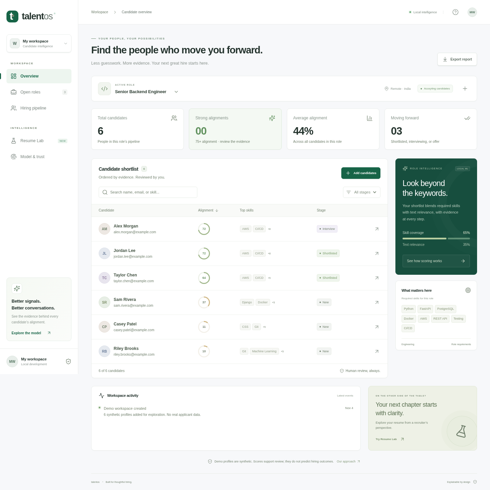

# TalentOS

**Candidate intelligence for thoughtful hiring.** A full-stack workspace that turns resumes into reviewable evidence, paired with a private Resume Lab for candidates.

Built from the original Resume Parser + JD Matcher with **React, TypeScript, FastAPI, SQLAlchemy, and scikit-learn**. Runs without paid APIs or cloud credentials.



## What works

- Create roles with explicit requirements and a searchable skill catalog.
- Upload up to 10 PDF, DOCX, or TXT resumes; detect duplicates and report individual file errors.
- Rank candidates with a versioned, explainable TF-IDF/skill-coverage model; inspect excerpts, matching terms, gaps, and score components.
- Compare up to three candidates against the same role requirements; edit a role and recalculate all scores atomically.
- Recover stale-note conflicts without losing your draft, safely delete roles, and return to unlock when access expires.
- Move candidates through New → Shortlisted → Interview → Offer, or Rejected; keep notes and a workspace activity trail.
- Export a role's candidates as CSV with spreadsheet-formula protection. Delete individual candidate records.
- Use **Resume Lab** to analyze a resume against a job description without saving it; explore skill gaps, truthful resume improvements, and evidence-based interview prompts.
- Inspect a model card that explains methodology, limitations, privacy, and human-review expectations.
- Explore six clearly marked synthetic candidates across three demo roles. No invented usage analytics or model accuracy claims.

## Quick start

Python 3.12 and Node.js 24 are the tested toolchain. No database service is required for local development.

```bash
python3 -m venv .venv
source .venv/bin/activate
python -m pip install -r requirements-dev.txt
npm ci --prefix frontend
npm run build --prefix frontend
python -m uvicorn backend.main:app --host 127.0.0.1 --port 8000
```

The API serves the compiled frontend on port 8000. On a local machine, open that port in your browser. The default first run creates synthetic demo data only if there are no roles. Set `TALENT_DEMO=0` before the first start for an empty workspace. Changing that variable does not erase an existing database.

For frontend hot reload, run `npm run dev --prefix frontend` in another terminal; Vite proxies `/api` to port 8000. For backend hot reload, add `--reload --reload-dir backend` to Uvicorn. Use the existing checkout in a cloud task; no worktree is required.

Local settings can be loaded with `--env-file .env` after copying `.env.example`; secrets must stay outside version control. Data defaults to `/workspace/.talentos`; set `TALENT_DATA_DIR` to another writable directory outside cloud environments.

## Validation

```bash
python -m pytest -q
ruff check backend migrations tests
ruff format --check backend migrations tests
npm run build --prefix frontend
```

Integration tests cover TXT/DOCX/PDF parsing, email preservation, invalid and oversized files, decompression limits, duplicate handling, persistence, stage transitions, candidate deletion, transient Resume Lab analysis, authentication, and rate limiting. Ranking tests check relevance ordering, score bounds, deterministic results, evidence, and contact/name invariance on controlled examples. These are engineering checks, not an accuracy or fairness certification on real applicants.

Browser smoke tests are in `frontend/e2e/`; see [validation](docs/VALIDATION.md) for commands and observed results.

`requirements.txt` contains runtime constraints; `requirements.lock.txt` freezes the tested Python 3.12 runtime dependency set. `requirements-dev.txt` adds pinned test/lint tools. `frontend/package-lock.json` locks frontend packages. Review and regenerate locks when updating dependencies.

## Deploy

```bash
docker build -t talentos .
# Supply TALENT_API_KEY through your secret manager or an exported shell variable.
# Never place its value in a committed file or command history.
docker run --rm -p 127.0.0.1:8000:8000 \
  -e TALENT_API_KEY -v talentos-data:/data talentos
```

The image runs as UID 10001, disables demo seeding, requires a 32+ character access key, and checks database-backed health. Put an HTTPS reverse proxy and request-size/rate limits in front of it. This is a single-workspace application with Alembic migrations and bounded extraction workers. A public multi-tenant service still needs per-user identity/authorization, stronger parser security isolation, managed monitoring, and an operational backup/restore policy. See [architecture and threat boundaries](docs/ARCHITECTURE.md).

For the PostgreSQL + API + nginx stack, see [production operations](docs/OPERATIONS.md) and run `docker compose up --build -d --wait` with the required secrets supplied securely. The gateway binds to loopback; connect your HTTPS ingress there.

For cloud builds using a session proxy, pass public CA certificates as BuildKit secrets (`proxy_ca` for npm, `proxy_bundle` for pip). TLS verification remains enabled and certificates are not baked into image layers.

## API highlights

| Method | Endpoint | Purpose |
|---|---|---|
| GET | `/api/health` | Database-backed readiness |
| GET / POST | `/api/jobs` | List / create roles |
| GET / POST | `/api/jobs/{id}/candidates` | Ranked list / batch uploads |
| PATCH / DELETE | `/api/candidates/{id}` | Version-checked update stage/notes / delete |
| PUT / DELETE | `/api/jobs/{id}` | Version-checked role edit/rescore / delete |
| GET | `/api/candidates/{id}/interview` | Evidence-based interview prompts |
| GET | `/api/jobs/{id}/export` | CSV export |
| GET | `/api/jobs/{id}/activity` | Workspace activity |
| POST | `/api/parse` | Transient structured extraction |
| POST | `/api/match` | Transient resume/JD analysis |

Interactive OpenAPI docs are at `/api/docs`. Protected deployments require an Authorization header for API access, including the docs; use a client that supports Bearer headers. Health and auth metadata remain public.

## Discussing this project in interviews

Walk through one complete request: bounded upload → structured extraction → pairwise vectorization → explainable report → transactional storage → human review. Explain the tradeoffs behind SQLite versus PostgreSQL, lexical retrieval versus embeddings, shared-key access versus multi-user identity, synchronous parsing versus isolated workers, and deterministic interview templates versus LLM generation. Strong engineering includes being precise about what is implemented and what remains.

The legacy pure-Python matcher and static frontend remain in the repository as references; the running application serves `frontend/dist` and uses `backend/intelligence.py` for new scores.
