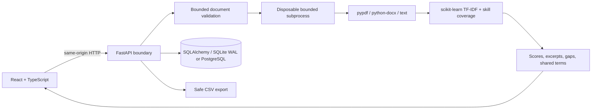

# Architecture & engineering decisions

TalentOS is a single-workspace portfolio application. Both recruiter workflows and the candidate Resume Lab share one parsing and ranking service.

## Why this stack

- **React + TypeScript + Vite** gives typed UI state, composable flows, and a small production bundle. Lucide supplies consistent SVG icons. The frontend uses same-origin API calls and requires no CDN, font service, or analytics tracker.
- **FastAPI + Pydantic** validates role inputs, pipeline updates, document endpoints, and OpenAPI contracts. Synchronous parsing/ranking runs in the framework's thread pool rather than blocking its async event loop.
- **SQLAlchemy + SQLite WAL** supports durable local workflows, transactions, unique resume hashes per role, cascading deletion, and concurrent readers. `DATABASE_URL` selects PostgreSQL through the included psycopg driver. The Compose deployment adds PostgreSQL, nginx ingress, health gates, and resource limits.
- **scikit-learn** provides real unsupervised document vectorization. No neural model, external generative service, or fabricated predictive accuracy is claimed.
- **Docker + CI** packages one deployable service with a compiled frontend, non-root execution, a persistent volume, and health checks. The committed pipeline runs API tests, linting, formatting, and the frontend type/build check.

## Data model

`Job` owns its `Candidate` records and activities. Candidates have a unique `(job_id, content_hash)`, parsed profile, extracted text, versioned scoring report, stage, notes, and synthetic-data flag. Original uploaded files are discarded after parsing. Batch processing uses savepoints so an invalid or duplicate file does not discard valid files in the same request.

Resume Lab parses and ranks in memory without writing the profile to the database. It returns no raw text. Recruiter deletion removes application records; secure erasure from SQLite pages, backups, filesystem snapshots, and infrastructure logs requires an operational retention policy. Do not equate deletion with forensic erasure.

## Scoring contract

`alignment = 0.65 × explicit_skill_coverage + 0.35 × lexical_relevance`

Lexical relevance is 80% word/bigram TF-IDF cosine similarity and 20% character n-gram similarity. Each resume/JD pair is fitted independently. Reports expose skill evidence, gaps, shared terms, model version, and weights. No other candidates affect a person's score. Name/contact strings are excluded from the text signal. Education/prestige are not explicit features, but free text can contain proxies.

This is retrieval and evidence organization, not a probability of employment or a predictor of job performance. Keyword stuffing and missing synonyms remain weaknesses. Human reviewers must assess evidence, accommodations, and context. The interview guide uses transparent templates conditioned on matched/missing skills; it does not call an LLM.

## Security boundary

Production refuses startup without a 32+ character `TALENT_API_KEY`. It is a shared workspace credential, not multi-user authentication. The browser keeps it in sessionStorage, sends it as a Bearer token, and can lock the workspace. Deploy only behind HTTPS. Same-origin access, constant-time credential comparison, no-store API responses, security headers, request IDs, bounded document reads, DOCX expansion limits, CSV formula escaping, and an in-process rate limiter provide a baseline.

The rate limiter is per process and keyed by the connection address; do not treat it as distributed abuse protection. Place an ingress proxy with request-size limits, TLS, and shared rate limiting in front of public deployments. Document parsing is not a malware sandbox. Document extraction now runs in disposable processes with CPU/memory/time/text/page limits and no inherited application credentials. Public anonymous ingestion still needs stronger worker security isolation, malware scanning, and user-level authorization. Alembic migrations are transactional and preserve the verified legacy schema; optimistic versions protect edits, and role-level compare-and-swap prevents stale upload scores. This release does not include SSO, multi-tenancy, cloud object storage, distributed jobs, OCR, or an audit-compliance guarantee.

See [production operations](OPERATIONS.md) for deployment, migrations, backups, resource budgets, and incident recovery.
